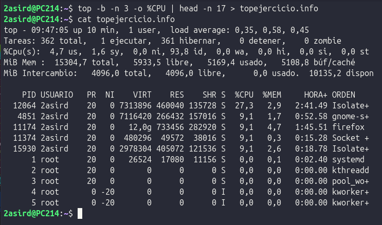
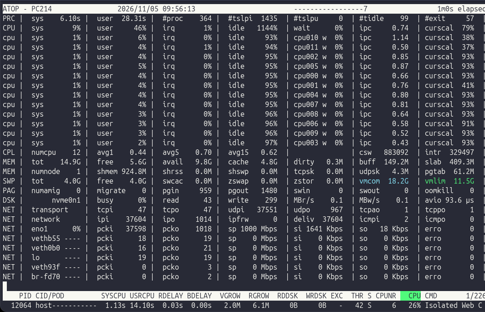
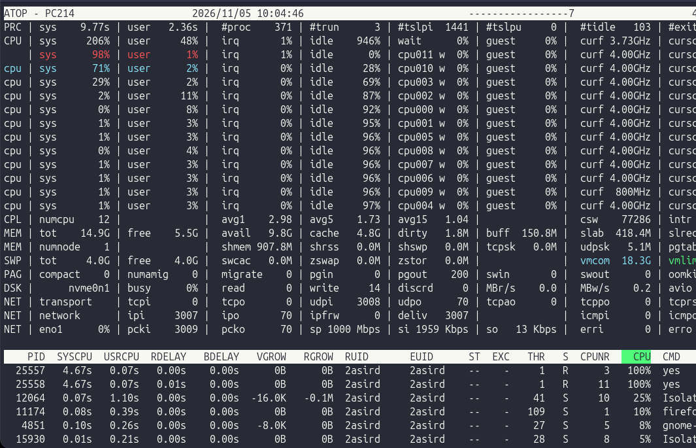

# Gestión y Monitorización de Procesos en Linux

---

## 1. El Comando `ps` (Process Status)

Muestra una instantánea estática del estado actual de los procesos en ejecución.

### Modos de uso comunes

* **`ps`**: Muestra únicamente los procesos asociados a la terminal actual del usuario activo.
  
  

* **`ps au`**: Añade detalle sobre el usuario propietario del proceso y el uso de recursos en terminales activas.
  
  

* **`ps aux`**: Lista **todos** los procesos en el sistema, incluidos los demonios y servicios en segundo plano sin terminal asociada.
  
  

### Filtrado y opciones útiles

| Opción / Parámetro | Función | Ejemplo de sintaxis |
| :--- | :--- | :--- |
| `-C <nombre>` | Filtra procesos por el nombre exacto del comando ejecutable. | `ps -C nginx` |
| `-u <usuario>` | Filtra los procesos pertenecientes a un usuario específico. | `ps -u www-data` |
| `u -C <nombre>` | Muestra información detallada de recursos para un proceso concreto. | `ps u -C sshd` |


---

## 2. Monitorización Dinámica: `top` y `htop`

### Comando `top`
Muestra una vista dinámica en tiempo real del uso de CPU, memoria y tareas del sistema.

#### Atajos de teclado interactivos (dentro de `top`)
* <kbd>P</kbd>: Ordenar por uso de **CPU** *(comportamiento por defecto)*.
* <kbd>M</kbd>: Ordenar por consumo de **memoria RAM**.
* <kbd>T</kbd>: Ordenar por **tiempo acumulado de CPU**.
* <kbd>N</kbd>: Ordenar numéricamente por **PID**.
* <kbd>R</kbd>: Invertir el orden de la clasificación activa *(ascendente / descendente)*.


#### Opciones de línea de comandos
* `-b` *(Batch mode)*: Ejecuta en modo por lotes; envía la salida directamente a texto plano o tuberías sin pantalla interactiva.
* `-n <número>`: Define la cantidad máxima de iteraciones o actualizaciones antes de salir automáticamente.


---

### Comando `htop`
Evolución visual e interactiva de `top` basada en ncurses.

* **Cabecera gráfica:** Barras de color para uso de núcleos de CPU, memoria swap y memoria principal.
* **Barra inferior de acciones directas:**
  * <kbd>F3</kbd>: Buscar proceso por nombre.
  * <kbd>F4</kbd>: Filtrar la lista en vivo.
  * <kbd>F6</kbd>: Seleccionar campo de ordenación.
  * <kbd>F9</kbd>: Enviar señales directas al proceso *(SIGTERM / SIGKILL)*.


---

## 3. Ejercicio Práctico

> **Enunciado:** Utilizando el comando `top`, necesitamos mandar a nuestro jefe de proyecto un listado de los 10 procesos que consumen más CPU durante 3 períodos consecutivos.

### Comando

```bash
top -b -n 3 | grep -A 11 -E "^ *PID"
```

### Explicación técnica:
1. `-b`: Activa el modo por lotes (*batch mode*), permitiendo capturar y canalizar la salida sin interfaz interactiva.
2. `-n 3`: Realiza exactamente 3 capturas consecutivas y finaliza.
3. `grep -A 11 -E "^ *PID"`: Captura la fila de encabezado de procesos (`PID ...`) y las siguientes 11 líneas (los 10 procesos con mayor consumo más el encabezado) de cada iteración.



---

## 4. Registro Histórico: `atop`

Herramienta avanzada de auditoría y monitorización continua que registra periódicamente el consumo de recursos a nivel de proceso, disco, red y memoria.

* **Ruta de logs por defecto:** `/var/log/atop/` (habitualmente nombrados como `atop_YYYYMMDD`).
* **Archivo de configuración:** `/etc/default/atop` (aquí se configuran los intervalos de muestreo y retención).

### Opciones y consulta de logs

* `-r`: Permite reproducir e inspeccionar un archivo de log previamente registrado:

```bash
atop -r /var/log/atop/atop_YYYYMMDD
```

* Durante la navegación con `-r`:
  * Pulsa <kbd>t</kbd> para avanzar al siguiente intervalo registrado.
  * Pulsa <kbd>T</kbd> para retroceder un intervalo.

  

