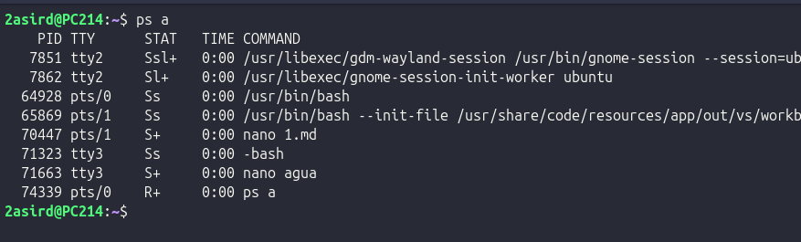
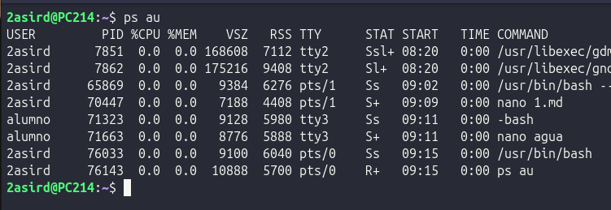
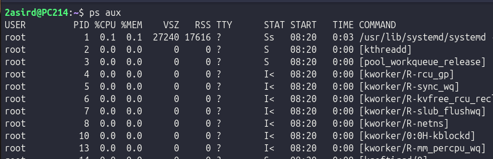
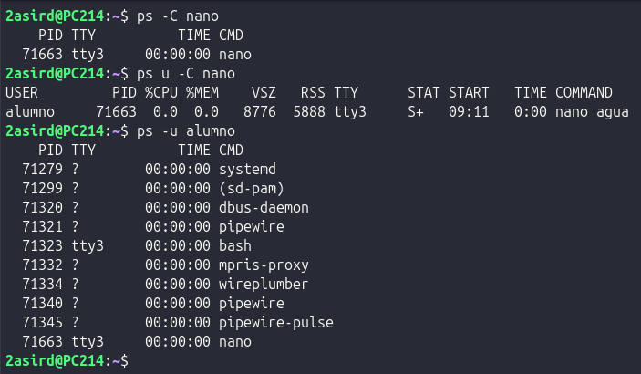
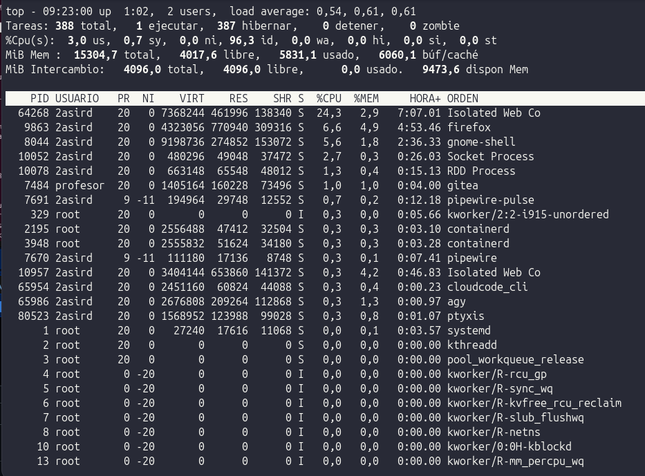
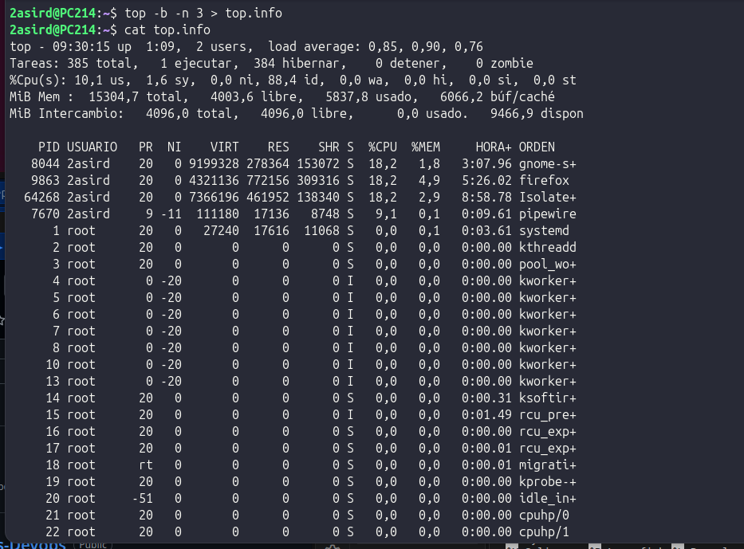
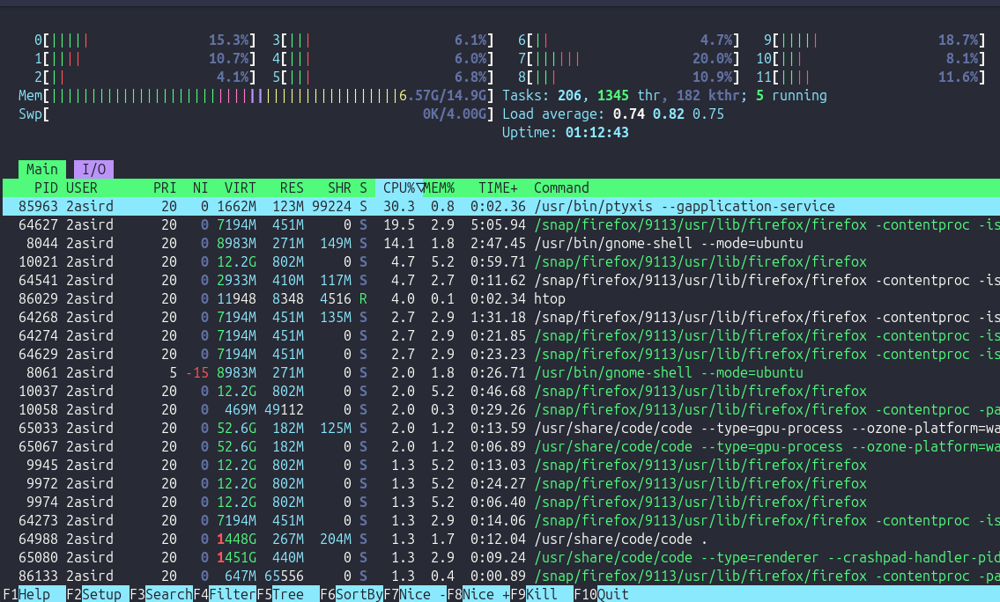

# PROCESOS

## Comandos:
### PS:
- ps: Muestra información de los procesos activos

- ps au: Muestra los procesos activos más detalladamente

- ps aux: Muestra todos los procesos, hasta los del sistema
 

### Opciones:
- -C: Sirve para buscar un proceso por el nombre
- u -C: Para mostrar más información relacionada con un usuario
- -u "usuario": Muestra todos los procesos que tiene un usuario

### TOP:
Muestra información del uso y los procesos del sistema
- M: Ordena los procesos por memoria
- P: Ordena los procesos por CPU
- T: Ordena los procesos por tiempo de uso
- N: Ordena los procesos por PID (Mayor a menor)
- R: Ordena los procesos por PID (Menor a mayor)

### Opciones:
- -b: No es interactivo, no se muestra por pantalla
- -n: (numero) Número de interacciones

### HTOP:
Interfaz gráfica del comando Top. En el inferior puedes Ordenar, Buscar y Terminar procesos.

### Ejercicio 1:
- Utilizando el comanto 'top' necesitamos mandar a nuestro jefe de proyecto un listado de los 10 procesos que consumen más CPU durante 3 períodos consecutivos

