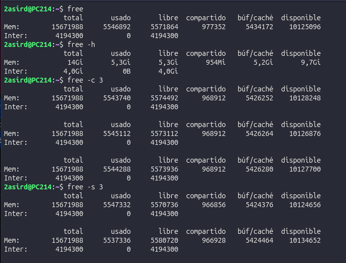
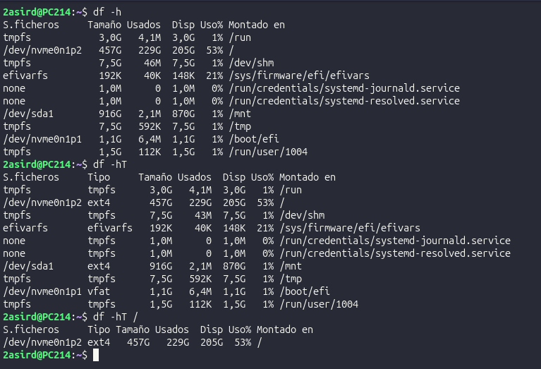
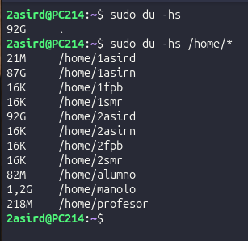
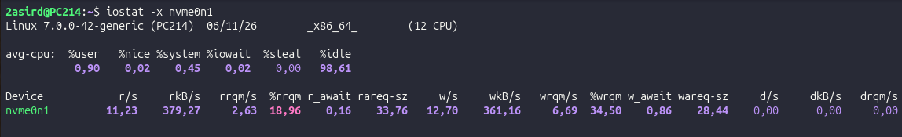
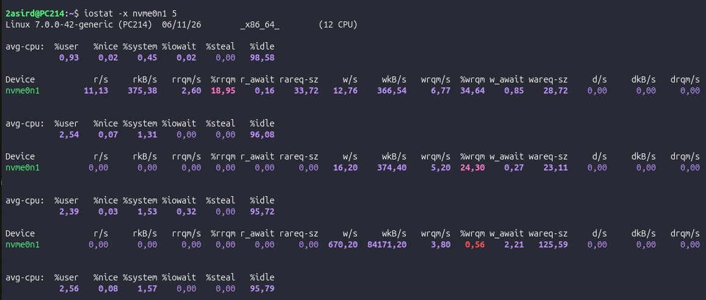

# Memoria, Espacio y Rendimiento en Disco en Linux

Guía rápida de comandos esenciales para la supervisión de memoria RAM, espacio en sistemas de ficheros y tasa de entrada/salida (I/O).

---

## 1. Monitorización de Memoria RAM: `free`

Muestra la cantidad total de memoria física (RAM) y de intercambio (Swap) en el sistema, detallando el espacio libre, usado, en caché y en búferes.

### Opciones habituales

| Opción | Descripción | Ejemplo |
| :--- | :--- | :--- |
| `-h` *(human-readable)* | Muestra los valores en unidades legibles (KiB, MiB, GiB). | `free -h` |
| `-s <segundos>` | Intervalo de refresco: actualiza la información cada $X$ segundos. | `free -h -s 2` |
| `-c <número>` | Contador de repeticiones: se detiene tras $N$ actualizaciones. | `free -h -c 5 -s 1` |

> **Ejemplo combinado:** Ejecutar `free -h -s 2 -c 3` actualizará los datos cada 2 segundos durante 3 iteraciones consecutivas.



---

## 2. Espacio en Sistemas de Ficheros: `df` (Disk Free)

Informa sobre el uso del espacio en disco de todos los sistemas de ficheros montados actualmente en el sistema operativo.

### Opciones habituales

| Opción / Parámetro | Descripción | Ejemplo |
| :--- | :--- | :--- |
| `-h` *(human-readable)* | Muestra el tamaño, uso y disponibilidad en GiB/MiB. | `df -h` |
| `-T` *(print-type)* | Añade una columna con el tipo de sistema de archivos (`ext4`, `xfs`, `btrfs`, `tmpfs`...). | `df -hT` |
| `<ruta_o_dispositivo>` | Consulta de forma específica la partición donde reside la ruta indicada. | `df -h /` |



---

## 3. Uso de Espacio por Archivos y Directorios: `du` (Disk Usage)

Calcula de forma recursiva el espacio ocupado por ficheros y directorios concretos en el disco.

### Opciones y patrones habituales

| Sintaxis | Descripción |
| :--- | :--- |
| `du -hs <directorio>` | Resumen global (`-s`) en formato legible (`-h`) del tamaño del directorio indicado. |
| `du -h --max-depth=1 <directorio>` | Desglose legible de los subdirectorios inmediatos sin listar recursivamente todo el árbol. |
| `du -hs /home/*` | Muestra el peso acumulado por cada carpeta de usuario o subdirectorio. |

```bash
# Comprobar el peso total de una carpeta concreta
du -hs /var/log

# Comparar el uso de disco de cada elemento dentro de un directorio
du -hs /directorio/*
```



---

## 4. Auditoría de Rendimiento de Entrada/Salida: `iostat`

Forma parte del paquete `sysstat`. Permite monitorizar la carga de los dispositivos de almacenamiento observando el tiempo que permanecen activos y sus tasas de transferencia (lectura/escritura). Resulta fundamental para detectar cuellos de botella en operaciones de disco.

### Opciones y modos de uso

| Opción / Sintaxis | Descripción |
| :--- | :--- |
| `iostat -x` | Muestra estadísticas extendidas (métricas de latencia, `%util`, tiempos de espera, etc.). |
| `iostat -x <dispositivo>` | Filtra las métricas extendidas para un disco o partición concreta (ej. `sda`, `nvme0n1`). |
| `iostat -x <dispositivo> <segundos>` | Monitoriza el dispositivo en tiempo real con muestreos periódicos. |

```bash
# Ejemplo: Monitorizar el disco sda cada 2 segundos con métricas extendidas
iostat -x sda 2
```



### Comprobación en carga activa
Al someter el sistema a operaciones de escritura intensiva (por ejemplo, al descargar un fichero pesado, compilar o transferir datos), se aprecia el incremento directo en las métricas de escritura (`kB_wrtn/s` o `w/s`) y en el porcentaje de saturación del disco (`%util`).


