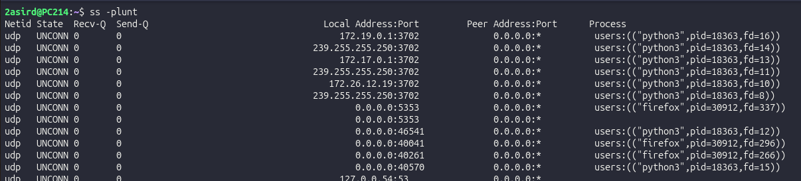

# Monitorización y Análisis del Tráfico de Red en Linux

Guía de utilidades para captura de paquetes, inspección de sockets activos, trazabilidad IP y control de ancho de banda.

---

## 1. Captura e Inspección de Paquetes: `tcpdump`

Herramienta de línea de comandos para capturar y analizar en tiempo real los paquetes que pasan por las interfaces de red del sistema.

### Opciones habituales

| Flag / Parámetro | Función | Ejemplo |
| :--- | :--- | :--- |
| `-i <interfaz>` | Selecciona la interfaz de red a escuchar (ej. `eth0`, `ens33`, `any`). | `tcpdump -i eth0` |
| `-n` | No resuelve nombres de dominio/host; muestra direcciones IP numéricas. | `tcpdump -n` |
| `-nn` | No resuelve nombres de host ni nombres de servicio/puerto (muestra IPs y puertos numéricos). | `tcpdump -nn` |
| `-v` / `-vv` / `-vvv` | Modo detallado (*verbose*); amplía la información de cabeceras de paquetes. | `tcpdump -v` |
| `-w <fichero.pcap>` | Vuelca los paquetes capturados en crudo a un archivo `.pcap` compatible con herramientas como Wireshark. | `tcpdump -i eth0 -w captura.pcap` |
| `-r <fichero.pcap>` | Lee y procesa un archivo `.pcap` previamente capturado. | `tcpdump -r captura.pcap` |


### Ejemplo de captura y lectura

```bash
# Capturar tráfico en eth0 sin resolución DNS y guardarlo en un fichero
sudo tcpdump -i eth0 -nn -w trafico_web.pcap

# Leer e inspeccionar la captura guardada
tcpdump -r trafico_web.pcap
```


---

## 2. Monitorización de Conexiones por Interfaz: `tcptrack`

Herramienta tipo ncurses que muestra una tabla en vivo con las conexiones TCP activas, su estado (SYN_SENT, ESTABLISHED, CLOSED), IPs origen/destino y su velocidad de transferencia en tiempo real.

| Flag | Función | Ejemplo |
| :--- | :--- | :--- |
| `-i <interfaz>` | Define la interfaz de red sobre la que se monitorearán las conexiones. | `tcptrack -i eth0` |

```bash
sudo tcptrack -i eth0
```


---

## 3. Consulta de Registro y Propietarios IP: `whois`

Cliente para consultar bases de datos distribuidas (RIRs como RIPE, ARIN, LACNIC) y obtener información pública sobre bloques de red, rangos de IP, dominios, proveedores de Internet (ISP) y datos de contacto del titular.

```bash
# Consultar información sobre una IP pública
whois 8.8.8.8
```


---

## 4. Análisis Visual e Interactivo: `iptraf-ng`

Monitor de tráfico interactivo en modo texto basado en menús que genera estadísticas IP detalladas, desglose por protocolos (TCP, UDP, ICMP), tamaños de paquete y recuento por interfaz.

```bash
# Iniciar interfaz gráfica en terminal (requiere permisos de superusuario)
sudo iptraf-ng
```


---

## 5. Visualización de Ancho de Banda: `bmon` (Bandwidth Monitor)

Monitor de depuración y ancho de banda en tiempo real. Presenta gráficos ASCII del volumen de paquetes transmitidos (`TX`) y recibidos (`RX`), tasas de transferencia instantáneas y errores en las interfaces.

```bash
bmon
```


---

## 6. Inspección de Sockets y Puertos: `ss` (Socket Statistics)

Sustituto moderno, rápido y directo de la herramienta clásica `netstat`. Permite comprobar los sockets abiertos, puertos a la escucha y las aplicaciones asociadas a cada uno.

### Modificadores principales

| Flag | Descripción |
| :--- | :--- |
| `-t` | Filtra únicamente sockets **TCP**. |
| `-u` | Filtra únicamente sockets **UDP**. |
| `-l` | Muestra exclusivamente puertos en estado de escucha (**Listening**). |
| `-p` | Muestra el **proceso** y PID responsable del socket (requiere `sudo`). |
| `-n` | No resuelve nombres de servicio; muestra el **número** de puerto de forma numérica. |

### Combinación habitual (`-tuln` / `-tulnp`)

```bash
# Listar todos los puertos TCP y UDP en escucha en formato numérico
ss -tuln

# Añadir el proceso/PID asociado a cada puerto a la escucha
sudo ss -tulnp
```


