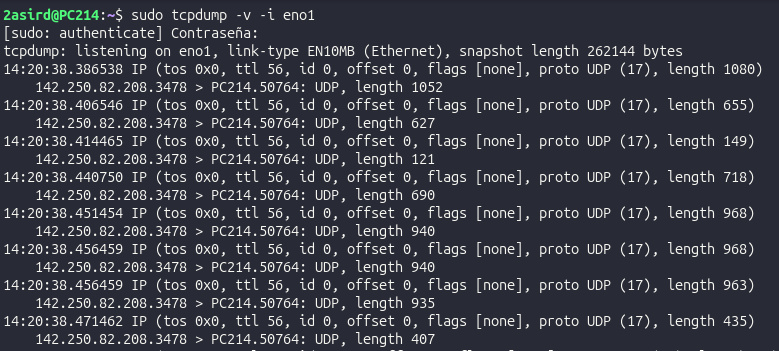
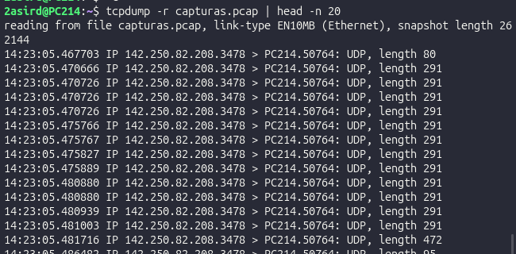
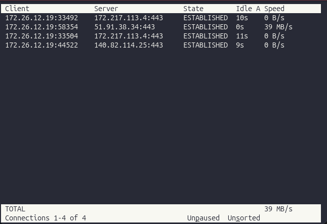
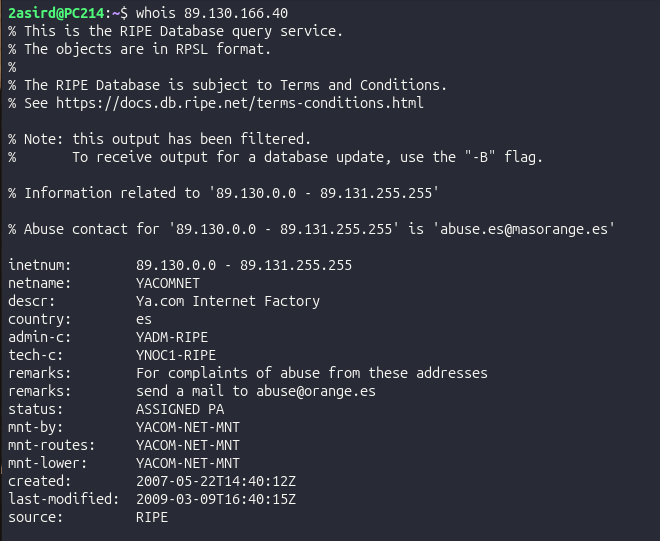
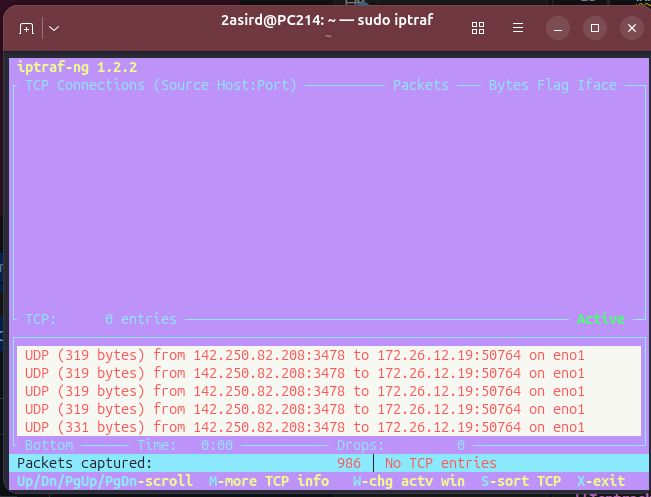
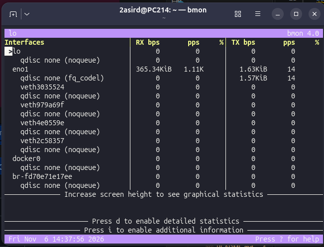

# TRÁFICO DE LA RED

## COMANDOS:
### TCPDUMP:
Sirve para ver el tráfico de paquetes en la red

### Opciones:
- -v: Verbose, para dar más info
- -i: Interfaz
- -n: Puerto

- -w (nombre.pcap): Para guardar los paquetes e info en un archivo que se puede visualizar
- -r (nombre.pacp): Para visualizar el archivo

### TCPTRACK:
Sirve para ver conexiones acticas y tráfico

### Opciones:
- -i: Seleccionar interfaz

### WHOIS
Sirve para ver información sobre una ip

### IPTRAF
Consulta el tráfico de forma más visual

### BMON
Te da una estadística de los paquetes transmitidos y recibidos

